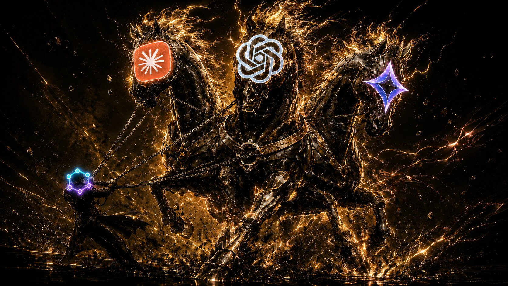

# Octie CLI



**State-oriented task graph kernel for the agentic era.**

Loop engineering substrate. Context engineering infrastructure. State is derived, not set. The task layer that every agent framework can call.

---

## Installation

```bash
npm install -g octie-cli
```

**Requirements**: Node.js >= 20.0.0

---

## Quick Start

```bash
# Initialize a project
mkdir my-project && cd my-project
octie init --name my-project

# Create a task
octie create \
  --title "Implement login endpoint" \
  --description "Create POST /auth/login with JWT authentication" \
  --success-criterion "Returns 200 with valid JWT" \
  --success-criterion "Returns 401 for invalid credentials" \
  --deliverable "src/auth/login.ts" \
  --deliverable "tests/auth/login.test.ts" \
  --priority top

# View tasks
octie list --graph
octie list --format md

# Start web UI
octie serve
```

---

## What is Octie?

Octie is a **state-oriented task graph kernel** — infrastructure for AI agent workflows. Not another todo list. A directed acyclic graph (DAG) where state is derived, not set.

### Loop Engineering Substrate

Design the system that prompts your agents — not the prompts themselves. Octie provides discovery, verification, memory, and guardrails for agent loops.

- **Discovery** — `octie list --status ready` finds work for agents
- **Verification** — Success criteria define when work is done
- **Memory** — Immutable snapshots persist state across sessions
- **Guardrails** — Atomic validation prevents vague, unexecutable tasks

### Context Engineering Infrastructure

Structured, typed, dependency-aware context for agents. Not just text — tasks, criteria, deliverables, blockers. The context that lives between steps.

### Agent-Native Task Layer

CLI-first, file-based, local-first. Designed for any shell agent — Claude Code, Codex, Gemini CLI, or any terminal-based AI.

### State-Oriented Architecture

Status is derived, not set. Five states compute from item completion and blockers. The system recalculates itself — agents cannot drift out of sync.

---

## Auto State Broadcast & Manual Approval

Two complementary mechanisms keep the task graph in sync:

### Auto State Broadcast

Status is never set manually. It derives from item completion and blockers, then propagates through the graph via BFS. When a parent completes, children unblock automatically.

```
ready → in_progress → in_review → completed
  ↑         ↑            ↑           ↑
auto      auto         auto       manual
```

```bash
# Status auto-derives when criteria are met
octie update <id> --complete-criterion <id>
```

### Manual Approval Gate

The only manual transition: `in_review → completed`. This is the human gate — the one moment where intent meets execution. Approval unblocks all dependent tasks.

```bash
# Only manual transition — the human gate
octie approve <id>
```

**Key insight**: Agents can work autonomously through `ready → in_progress → in_review`, but only a human can approve the final transition to `completed`. This ensures quality control while maximizing agent autonomy.

---

## CLI Commands

| Command | Purpose |
|---------|---------|
| `octie init --name <name>` | Initialize project (name required, must be unique) |
| `octie create` | Create atomic task |
| `octie list` | List tasks (with filters) |
| `octie get` | Get task details (`--fields` to narrow the payload) |
| `octie update` | Update task (criteria, deliverables, blockers, need_fix) |
| `octie approve` | Approve task (in_review → completed) |
| `octie delete` | Delete task |
| `octie merge` | Merge two tasks |
| `octie wire` | Insert task in dependency chain |
| `octie graph` | Graph operations (validate, cycles, chain) |
| `octie handoff` | Create loose subproject handoffs (child Octie projects) |
| `octie export` | Export to MD/JSON |
| `octie import` | Import from MD/JSON |
| `octie history` | View/restore snapshots |
| `octie panel` | Read-only overview of the project and its subprojects |
| `octie registry` | Maintain the global project registry (`prune` stale entries) |
| `octie config` | Get/set project-level configuration |
| `octie serve` | Start web UI |
| `octie find` | Search tasks (by status, priority, blockers) |

Run any command with `--help`, or print a built-in guide with a `--right-way-to-*` flag (e.g. `octie --right-way-to-form-tasks`; handoffs have their own: `octie handoff create --right-way-to-create-subtask-handoff`).

---

## DeepSeek Harness Plugin

Octie also ships as a DSH bundle plugin — the same task graph, inside your DSH agent:

```bash
dsh plugin --profile <name> add octie-cli
```

- **13 `octie_*` model tools** (`octie_create`, `octie_update`, `octie_approve`, `octie_handoff`, …) registered directly in the model's tool surface
- **Sidebar task panel** in the DSH web GUI with live list/DAG graph views
- **Pre-provisioned agent preset** on plugin load, with a settings card for template updates

---

## For AI Agents

```bash
# Get ready tasks (markdown format for AI)
octie list --status ready --format md

# Get task details — narrow the payload to save context
octie get <task-id> --format md
octie get <task-id> --format json --fields status,title

# Mark progress
octie update <id> --complete-criterion <criterion-id>
octie update <id> --complete-deliverable <deliverable-id>

# Withdraw a need_fix item that no longer applies (never executed, never blocks)
octie update <id> --withdraw-need-fix <need-fix-id>

# Status auto-derives: ready → in_progress → in_review
# Approve to unblock dependents
octie approve <id>
```

---

## Agent Skills

This repository includes skills for any shell agent that provide structured workflows for working with Octie:

| Skill | Purpose |
|-------|---------|
| [octie-install](skills/octie-install/) | Install and configure Octie CLI |
| [octie-research](skills/octie-research/) | Deep research using search tools |
| [octie-plan](skills/octie-plan/) | Create atomic tasks with dependencies |
| [octie-dev](skills/octie-dev/) | Development loop with audit trails |
| [octie-fix](skills/octie-fix/) | Bug investigation and fix preparation |
| [octie-refine](skills/octie-refine/) | Graph refinement and optimization |

### Installing Skills

Copy the skills to your agent's skills directory:

```bash
# For Claude Code
cp -r skills/* ~/.claude/skills/

# For other agents, copy to their respective skill directories
# or use the skills directly from this repository
```

---

## Task States

Octie uses 5 auto-derived states:

| State | Description |
|-------|-------------|
| **ready** | No blockers, prerequisites met, ready to start |
| **in_progress** | Work has started, some items completed |
| **in_review** | All items complete, awaiting approval |
| **completed** | Approved and done |
| **blocked** | Has unresolved blockers or prerequisites |

Status is **never set manually** — it derives from item completion and blockers.

---

## Links

- **Website**: [GitHub Pages](https://starchen-cycler.github.io/octie-cli/)

---

## License

MIT
